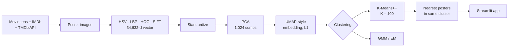
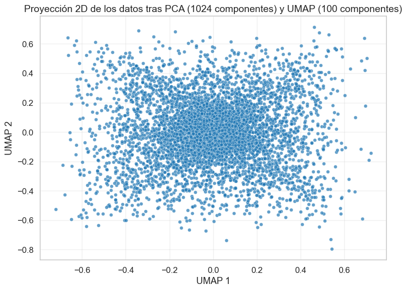
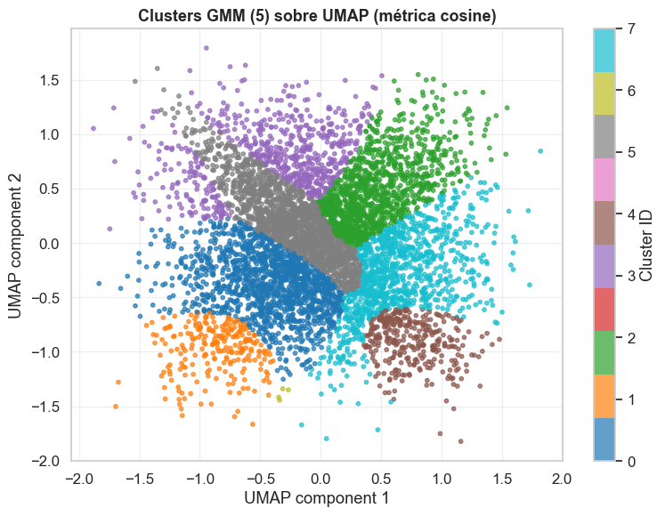

# Movie Poster Visual Recommender

**An unsupervised recommender that suggests movies whose posters *look* alike, using classical computer-vision descriptors, dimensionality reduction (PCA + a UMAP-style embedding) and clustering (K-Means and GMM). Core algorithms are implemented from scratch with NumPy/SciPy.**


> 🇪🇸 **Resumen:** Sistema de recomendación de películas basado solo en sus pósters. Se integraron 3 fuentes de datos (MovieLens, IMDb y la API REST de TMDb), se convirtió cada póster en un vector de 34 632 rasgos de color, textura y forma (HSV, LBP, HOG, SIFT), se redujo con PCA y un embedding tipo UMAP implementados desde cero, y se compararon K-Means y GMM con 3 métricas de calidad. El mejor modelo (K-Means) alimenta una app en Streamlit que, dada una película, recomienda otras visualmente similares. **Mi aporte:** implementación del GMM desde cero (algoritmo EM) y desarrollo de la aplicación.

---

## Highlights

- **Data integration:** MovieLens IDs joined with IMDb poster links (`MovieGenre.csv`); missing or broken posters were fetched from the **TMDb REST API** (JSON). **95.9%** of the 6,820 training movies ended up with a valid poster.
- **Visual features:** one **34,632-dimensional** vector per poster, combining an HSV color histogram, Local Binary Patterns (texture), HOG (shape/composition) and SIFT (local keypoints).
- **From-scratch implementations:** PCA (truncated SVD), a UMAP-inspired neighbor-graph embedding with L1 distance, **Gaussian Mixture Model (EM)** and K-Means++.
- **Evaluation** with silhouette, Davies–Bouldin and Calinski–Harabasz scores across many cluster counts.
- **Streamlit app** to pick a movie and browse its visually closest posters.

## Pipeline



At inference time, a test movie is mapped through the saved scaler, PCA, embedding and K-Means models (`.pkl`), assigned to a cluster, and the closest training posters inside that cluster are returned as recommendations.

## Results

Clustering quality on the 2-D PCA → UMAP-style (L1) embedding:

| Model | Clusters | Silhouette ↑ | Davies–Bouldin ↓ | Calinski–Harabasz ↑ |
|---|---|---|---|---|
| **K-Means++** | 5 | **0.353** | 0.860 | **3615.2** |
| K-Means++ (used in the app) | 100 | 0.331 | **0.796** | 3435.7 |
| GMM (best) | 4 | 0.278 | 1.038 | 2736.2 |
| GMM | 8 | 0.195 | 1.094 | 2126.2 |

<details>
<summary>Full sweep</summary>

**GMM**

| Components | Silhouette | Davies–Bouldin | Calinski–Harabasz |
|---|---|---|---|
| 2 | 0.298 | 9.805 | 27.95 |
| 4 | 0.278 | 1.038 | 2736.20 |
| 6 | 0.158 | 1.584 | 1694.12 |
| 8 | 0.195 | 1.094 | 2126.15 |
| 10 | 0.140 | 1.078 | 1814.82 |
| 15 | 0.090 | 1.324 | 1838.34 |
| 20 | 0.129 | 1.049 | 1972.85 |

**K-Means++**

| K | Silhouette | Davies–Bouldin | Calinski–Harabasz |
|---|---|---|---|
| 5 | 0.353 | 0.860 | 3615.16 |
| 10 | 0.321 | 0.869 | 3426.18 |
| 15 | 0.322 | 0.819 | 3453.62 |
| 30 | 0.319 | 0.832 | 3329.65 |
| 50 | 0.324 | 0.812 | 3357.79 |
| 100 | 0.331 | 0.796 | 3435.74 |

</details>

| PCA (1,024) + UMAP-style embedding | GMM clusters on the 2-D embedding (8 components) |
|---|---|
|  |  |

**Takeaways**

- **K-Means** gave the best-separated clusters. K = 100 keeps a near-top silhouette score and gives finer groups, which suit recommendations better.
- **GMM** assigns soft memberships and allows elliptical clusters. It scored lower here, probably because the embedded data is not clearly Gaussian.
- Silhouette scores around 0.3 mean the **clusters overlap moderately**. This is expected: posters from different genres often share colors, layouts and typography.
- In qualitative checks the recommendations share **visual style** (character-centered compositions, dominant color palettes) more than genre. For example, *Sleepless in Seattle* returns mostly comedy/drama posters with centered characters and warm or neutral backgrounds.

## My role

Team project for the Machine Learning course at UTEC (Lima, Peru).

- **Jean Piero Barboza Santa Cruz:** Gaussian Mixture Model implemented from scratch (initialization, E-step, M-step, log-likelihood convergence) and the Streamlit application.
- Piero Sánchez Garay: theory section, dimensionality-reduction algorithms (PCA, UMAP-style embedding), results processing.
- Valentina Álvarez Beraun: feature extraction, poster collection, K-Means implementation.

## Repository structure

```
├── clustering_pipeline.ipynb   # PCA, UMAP-style embedding, GMM and K-Means experiments (with outputs)
├── data/                       # extracted features (not versioned, ~3 GB, see data/README.md)
├── images/                     # figures used in this README
└── requirements.txt
```

> **Note:** the notebook imports the from-scratch `GMM` and `KMeans_Robusto` classes from `GMM_model.py` and `KMeans_Robusto.py`. Those files and the Streamlit app are being added to this repository.

## How to run

```bash
git clone https://github.com/jeanpieroCode/movie-poster-visual-recommender.git
cd movie-poster-visual-recommender
python -m venv .venv && source .venv/bin/activate   # Windows: .venv\Scripts\activate
pip install -r requirements.txt
# put the feature CSVs in data/ (see data/README.md)
jupyter notebook clustering_pipeline.ipynb
```

## Limitations and next steps

- **Richer image features:** replace hand-crafted descriptors with pretrained embeddings (ResNet, CLIP) to capture artistic style and context.
- **Multimodal signal:** combine poster features with text (synopsis, genres).
- **Density-based clustering:** try HDBSCAN to handle irregular cluster shapes and under-represented genres such as Sci-Fi.
- **Embedding:** benchmark the from-scratch embedding against `umap-learn`. The library version adds repulsive forces (negative sampling) that spread clusters apart.
